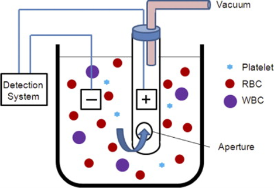

### Theory
Blood is an essential fluid connective tissue that circulates throughout the body, enabling constant communication between tissues and supporting proper body function. The main function of the blood is to maintain intracellular homeostasis by carrying oxygen and nutrients such as glucose, lipids, amino acids and vitamins to the body tissues and removing waste such as nitrates, creatine, and nucleic acids away from the body cells. It also provides intercellular communication in the body by carrying hormones secreted by endocrine glands to the target organs. It also transports immune cells and proteins to fight infections. As a self-repair mechanism, it helps to stop bleeding through the formation of blood clots (clotting cascade).

Blood is composed of two fractions: Plasma and Formed Elements.

#### Plasma
It is the non-living extracellular matrix that composes about 55% of total blood volume. The plasma is constituted of 90-92% water and 7% plasma proteins. The main plasma proteins are albumins and globulins. Albumins constitute 60% of the total plasma protein and function to maintain normal plasma osmotic pressure. They act as a carrier molecule for drugs, steroid hormones, and free fatty acids. Globulins act as immunoglobulins (antibodies) to transport some hormones and mineral salts; for example, transferrin carries the mineral iron. They also function in the inhibition of some proteolytic enzymes and act as clotting factors responsible for blood coagulation. Plasma also contains inorganic salts such as calcium (Ca²⁺), sodium (Na⁺), potassium (K⁺), and phosphate (PO₄³⁻), responsible for maintaining normal body functions such as muscle contraction, transmission of nerve impulses, and maintaining proper fluid balance. Moreover, waste products such as urea, creatinine, and uric acid are transported by blood plasma to the kidneys for removal from the body. 
&nbsp;

#### Formed Elements
Formed elements are living cells that are composed of about 45% of total blood volume. The three types of blood cells are Red Blood Cells (RBCs), White Blood Cells (WBCs), and Platelets.

&nbsp;

#### Red Blood Cells (RBCs)
RBCs are also known as erythrocytes. RBCs are biconcave discs, and their shape facilitates both volume and surface area.  RBCs are biconcave discs and their shape facilitates both volume and surface area for gas exchange. RBCs constitute about 40%-45% of blood volume. It is generated from bone marrow and have a lifespan of 120 days in the body. They have no nucleus and cytoplasmic organelles. It contains a red coloured protein called haemoglobin and functions in gas transport, mainly O2, and carries some CO2. It is responsible for the transport of O2 from lungs to tissues and CO2 from tissues to the lungs. RBCs have a diameter of 7.5 µm, a thickness of 2.6 µm at the rim, and 0.8 µm thickness in the center. The process of RBC development from stem cells takes about 7 days and is called erythropoiesis. 

Haemoglobin is made up of large and complex molecules such as heme and globin. Heme is made up of iron and porphyrin. Globin is a protein with 4 polypeptide chains (2 alpha and 2 beta). Each haemoglobin (Hb) molecule contains four heme groups that are attached to globin protein chains. Each heme group binds with one molecule of O2. Therefore, one haemoglobin molecule can carry four oxygen molecules.  Each RBC carries about 280 million Hb molecules and can carry over a billion O2 molecules. Hb with O2 is called oxyhaemoglobin, and Hb without O2 is called deoxyhaemoglobin. The amount of haemoglobin in whole blood is expressed in grams per deciliter (g/dl). The normal Hb level for males is 14 to 18 g/dl; that for females is 12 to 16 g/dl.
Cells (WBCs), and Platelets.

&nbsp;

#### White Blood Cells (WBCs)
White blood cells are also known as leukocytes and are part of our immune system. Leukocytes are the largest blood cells and constitute only about 1% of the blood volume. Like RBCs, they are constantly generated in the bone marrow. They are essential for protection against illness and diseases as they flow through the bloodstream attacks any foreign bodies like viruses and bacteria. Leucocytes are true cells having a nucleus, mitochondria and other cell organelles. Unlike erythrocytes, leucocytes have mobility and can leave the blood and enter the surrounding tissues. They have only a short life span/. They do not contain haemoglobin molecules. There are two main types of WBCs: granulocytes and agranulocytes. Granulocytes contain granules in their cytoplasm; they include neutrophils, eosinophils and basophils. Agranulocytes do not contain granules in their cytoplasm, and they include monocytes and lymphocytes. 60-70% of total WBC represents Neutrophils, 20-30% lymphocytes, 3%, eosinophils, 1% basophils and 5% monocytes. Neutrophils are 12-15 µm in diameter, with a nucleus consisting of 2-5 lobes. They have phagocytic activity against foreign particles and a short half-life of 6-7 hours in blood and 1-4 days in the tissues. Eosinophils have a bilobed nucleus, and the cytoplasm of eosinophils contains large granules that contain a protein called the major basic protein, which has the ability to kill parasitic worms. The number of eosinophil cells in the blood determines the allergic reaction and parasitic infection. Basophils constitute less than 1% of blood leukocytes. They are about 12-15 µm, and the nucleus has S-shaped irregular lobes. The cytoplasm contains very large granules, mainly histamine and heparin, which play an important role in allergies. Lymphocytes are spherical cells with a diameter of 6-8 µm (small lymphocytes) and up to 18 µm (large lymphocytes). The nucleus is large and rounded, with a varying lifespan (from a few days to many years). Lymphocytes are classified into B lymphocytes, T lymphocytes, and Natural Killer cells according to their functions. The major functions are related to immune reactions against foreign macromolecules, invading microorganisms, and cancer cells. Monocytes are the largest of the white blood cells with a horseshoe- or kidney-shaped nucleus. The lifespan in the circulation is a few days, but 60-120 days in the tissues. The monocyte performs phagocytosis and secretes certain substances like interleukins, e.g., interleukin 1 (IL-1) and has important functions in inflammation and immunity. 

&nbsp;

#### Platelets
Platelets are also called Thrombocytes. Unlike red and white blood cells, platelets are not actually cells but non-nucleated small cell fragments with 2-4 µm in diameter and look like small plates in their non-active form. Platelets promote the blood clotting process by gathering at the injured blood vessel, sticking to its surface, and forming a platform that supports blood clot formation. Platelets have a short lifespan of about 10 days. 

The different types of blood cells are shown in Figure 1.

 
  <i>Figure 1: Types of blood cells. 

(image source  https://www.cancer.gov/publications/dictionaries/cancer-terms/def/red-blood-cell)
</i>

&nbsp;

#### Staining of blood cells
Blood staining is a fundamental laboratory procedure used in haematology to colour and differentiate the distinct components of a blood smear. The classic staining procedure is Wright or Wright-Giemsa Stain, which belongs to the Romanowsky stain. The purpose is to examine the peripheral blood smear and to identify different blood cells. The dye is a combination of an acidic dye, eosin Y (red colour), oxidised methylene blue and a basic dye, Azure B (blue colour) and a methanol solvent. The methanol component helps to fix the blood cells onto the glass slide. The addition of buffer solution activates the dyes and produces thiazine-eosin complexes. After staining, the acidic components attract blue or purple dyes, and basic components attract acidic red or pink dyes. 

##### Appearance of blood cells after staining: 
* **Red blood cells (RBCs):** Red to pink
* **Nucleus of WBCs:** Dark blue or purple
* **Platelets:** Central red-purple granules with a light blue halo
* **Neutrophils:** Pale pink cytoplasm, lilac granules
* **Eosinophils:** Pale pink to light blue, Orange-red granules
* **Basophils:** Pale pink, Dark blue-purple granules
* **Lymphocytes:** Light blue cytoplasm, deep violet nucleus
* **Monocytes:** Gray-blue cytoplasm, bluish-purple nucleus

&nbsp;

#### Introduction to Haematology Testing
Haematology is a branch of science that studies blood, its components, and the blood-forming organs. Haematological investigations are important diagnostic tools in clinical laboratories for diagnosing and evaluating various health conditions, including anaemia, blood infections, bleeding-related disorders, and blood-related cancers. One of the routinely suggested haematological investigations by healthcare professionals is the Complete Blood Count (CBC), which provides valuable information about the overall health status and composition of blood of an individual. It measures the levels and characteristics of the major cellular components of blood, including red blood cells (RBCs), white blood cells (WBCs), and platelets. The test is performed using an automated haematology analyser, that examines a blood sample collected in an anticoagulant-containing tube, commonly containing EDTA (Ethylenediaminetetraacetic acid). 

&nbsp;

#### Working Principles of Automated Haematology Analysers 
The automated haematology analysers employ advanced technologies to count blood cells, measure their size, determine haemoglobin concentration, and differentiate WBCs. The working principles include electrical impedance, optical light scattering, and spectrophotometry.

The **electrical impedance**, also known as the Coulter Principle, is the commonly used method for counting and understanding the size of the blood cells by measuring the changes in electrical resistance when cells pass through a tiny opening. The diluted blood sample in an ionic, electrically conductive solution is passed through a small opening called an aperture (orifice). Electrodes are placed on either side of the aperture. An electric current flows continuously between these internal electrodes. Blood cells are non-conductive (poor electrical conductors); when the blood cells pass through the aperture, a voltage pulse or a resistance spike is produced. The count of these spikes gives the total cell count. The height of the magnitude of the generated voltage pulse is directly related to the physical size of the cells. RBCs and WBCs are bigger in size than platelets (Figure 2).

 
  <i>Figure 2. Automated Impedance Haematology Analysers. 

(image source: image source: DeNicola DA. Advances in haematology analysers. Topics in companion animal medicine. 2011 May 1;26(2):52-61.)
</i>

&nbsp;

The **spectrophotometric principle**, **Beer-Lambert's Law**, is used to measure haemoglobin concentration in blood, where the absorbance of a colored solution is directly proportional to its concentration. To determine the haemoglobin concentration, the first step is RBC lysis and conversion, where the blood sample is mixed with Drabkin’s solution, a dilution fluid containing potassium ferricyanide and potassium cyanide.  Next is the oxidation step, where the potassium ferricyanide oxidises ferrous iron in the haemoglobin to ferric iron and converts all forms of haemoglobin to methaemoglobin. In the cyanide binding stage, the potassium cyanide binds with methaemoglobin to form cyanmethaemoglobin, a stable brown red coloured complex. This complex absorbs light at a specific wavelength of 540nm. The optical density, that is, the intensity of the color, is directly related to the concentration of haemoglobin in the blood sample. 

&nbsp;

Hb Concentration = (Absorbance of the test sample/Absorbance of the standard) x Known Hb concentration of the standard

&nbsp;

The **Optical detection** principle is applied to analyse blood cells using light-based signals. Blood cells are suspended in a suitable fluid and passed individually through a narrow flow channel. An illuminated light or laser beam illuminates the cells. When the light interacts with the blood cells, it gets scattered at different directions. The analyser measures the light scattered by cells as they pass through an illuminated detection area. Forward scattering detects the cell size, and the side scattering detects the internal complexity and granularity of the specific blood cells.

A complete CBC report provides information about RBCs, WBCs, Hb count, Hematocrit (HCT), Platelets and Red-cell indices. The reports were widely used to identify anemia, certain infections, inflammation, and certain blood disorders. Clinically low RBC count is indicative of anaemia or blood loss, and a high RBC count is associated with dehydration or certain blood disorders. Increased WBC count known as leucocytosis, is indicative of infection or inflammation and, Decreased WBC count (leukopenia) is associated with viral infections or bone marrow disorders. Low platelet count (thrombocytopenia) may increase the risk of bleeding, whereas high platelet count (thrombocytosis) may increase the risk of abnormal clot formation in some conditions. The Hb count helps to identify anemia, the oxygen-carrying capacity of blood, and helps in monitoring other medical conditions. Hematocrit is the percentage of total blood volume occupied by red blood cells. If the HCT value is 35%, that means that approximately 35% of the blood volume consists of red blood cells. Low HCT relates to anaemia or blood loss, and high HCT is indicative of dehydration or increase in the RBC production.

&nbsp;

Red blood cell indices in the CBC report describe the average size and haemoglobin content of red blood cells, useful in classifying different types of anemia. The three main red cell indices are:

**Mean Corpuscular Volume (MCV)** - The average size and volume of RBCs. MCV is reported in units called femtoliters (fL). The adult normal range of MCV is between 80 and 100 fL. If the MCV is low (< 80 fL), the condition is Microcytic Anemia, where the red blood cells are smaller than normal.  Common causes included Thalassemia (an inherited blood disorder), Anaemia due to chronic disease or inflammation, Iron-deficiency anaemia due to heavy menstral cycle or gastrointestinal bleedings, Lead poisoning, Sideroblastic anaemia due to a rare bone marrow disorder where iron is not properly incorporated into haemoglobin. If MCV is high (> 100 fL), it is referred to as Macrocytic Anemia, where red blood cells are larger than normal. The main types include megaloblastic anaemia which occurs due to a lack of Vitamin B12 or Vitamin B9 (folate) and impaired DNA synthesis and non-megaloblastic anemia, where the cells are large due to membrane changes, rapid cell turnover, or direct bone marrow effects, and DNA synthesis is normal. If the MCV value is normal (80–100 fL ) with normocytic anaemia the red blood cells are a normal size, still an anaemia condition due to sudden blood loss, kidney failure, or haemolysis. 

**Mean corpuscular haemoglobin (MCH)** refers to the average amount of haemoglobin per red blood cell. A low MCH level indicates red blood cells contain less haemoglobin than normal and a high MCH reading indicates red blood cells contain a higher-than-average amount of haemoglobin. The common causes were similar conditions that were discussed in the case of MCV values. 

**Mean Corpuscular Haemoglobin Concentration (MCHC)** in a CBC report indicates the average concentration or density of haemoglobin inside a single red blood cell. Adult normal range is betweeb 32 to 36 g/dL (grams per deciliter). A low MCHC indicates red blood cells contain a lower concentration of haemoglobin than normal relative to their size. In this condition, the cells look paler than usual under a microscope, known as hypochromia. A high MCHC means concentrated haemoglobin inside the red blood cells. 

**Red blood cell distribution width (RDW)** in a routine CBC report measures the variation in the size and volume of erythrocytes. 

Other common diseases reported using a CBC report in a clinical laboratory include:

* **Acute Bacterial Leukocytosis**, where an elevation in the total WBC count is reported in the CBC report, typically exceeding 11,000 cells/µL in adults due to an infection or inflammation in the body.

* **Thrombocytopenia**, a low platelet count below 150,000/mm³, is due to dengue virus infection. 

* **Polycythemia vera**,  a rare, slow-growing blood cancer resulting in the bone marrow producing too many red blood cells, and often white blood cells and platelets.

&nbsp;

#### Applications
1. Diagnosis of anemia.

2. Detection of bacterial, viral, and other infections.

3. Diagnosis of blood disorders such as leukemia, sickle cell anemia, and other blood-related diseases.
